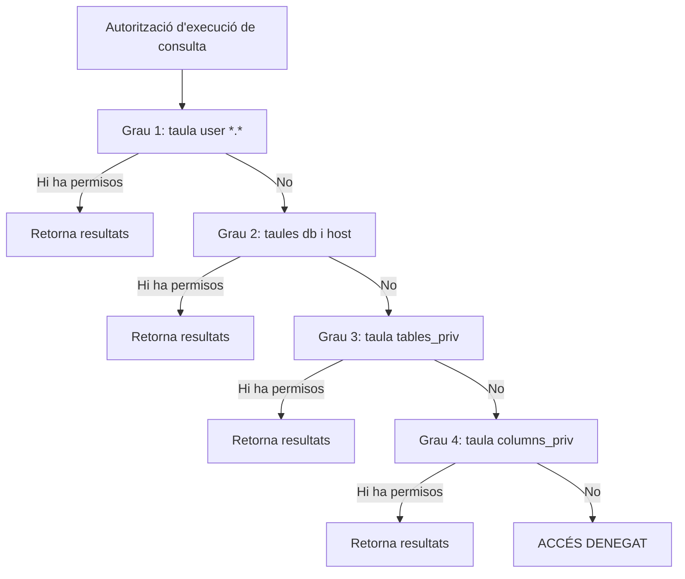

# 11. Seguretat en l'SGBD i control d'accés

[← Tornar a l'índex](README.md)

## 11.1 Mecanismes bàsics de seguretat de l'SGBD

La seguretat d'un SGBD ha de cobrir:

- **L'accés i l'ús de la base de dades a nivell de sistema**: creació d'usuaris, noms d'usuari i contrasenyes, assignació d'espai de disc als usuaris.
- **L'atorgament de privilegis de sistema** als usuaris per fer tasques com crear taules, vistes i seqüències.

Per aconseguir-ho es fan servir tres mecanismes:

| Mecanisme | Pregunta que respon | Descripció |
|---|---|---|
| **Identificació** | Qui és? | Manera en què l'usuari proporciona la seva identitat al sistema. Una identitat pot descriure un individu, més d'un individu, o un o més individus només durant un període de temps. |
| **Autenticació** | És qui diu que és? | Manera en què un individu estableix la validesa de la seva identitat. |
| **Autorització** | Què pot fer? | Mecanismes que asseguren que els usuaris només accedeixen als llocs on estan autoritzats i només poden fer allò per al qual tenen permís. |

## 11.2 Elements bàsics de la seguretat en l'SGBD

- **Usuaris**: cadascuna de les persones que accedeix a l'SGBD.
- **Objectes**: cadascun dels elements de la BD (dades, columnes, taules, vistes, procediments…).
- **Operacions**: accions que els usuaris poden fer sobre els objectes (lectura, escriptura, modificació, assignació de permisos…).

## 11.3 Control d'accés discrecional (DAC)

**Control d'accés**: conjunt de funcions de l'SGBD per assegurar que els accessos al sistema compleixen les regles establertes per la política de protecció fixada pel model de negoci.

El **control d'accés discrecional (DAC)** es basa en la **identitat dels usuaris o grups d'usuaris** per autoritzar o restringir l'accés als objectes de la BD. És el mecanisme més comú en els sistemes d'informació actuals.

En el DAC, un **privilegi** és l'autorització d'un usuari per fer una operació sobre un objecte.

> Exemple (diagrama): un administrador defineix una política; un mòdul d'aplicació de la política (*policy enforcement*) decideix per a cada usuari (Edna, Thuy, Irina) a quines taules o columnes pot accedir. Algunes columnes etiquetades (PII, Finance, Sensitive) queden denegades o es mostren emmascarades (*masked column*).

## 11.4 Control d'accés basat en rols (RBAC)

Alternativa al DAC, **igual de segura però més flexible i fàcil de mantenir** per a l'administrador:

1. Es creen **rols** que agrupen un conjunt de privilegis similars.
2. S'assignen un o més rols als usuaris.

Un **rol** és un conjunt d'accions associades a una activitat concreta.

**Exemple — privilegis per rol** (r = lectura, w = escriptura, x = execució):

| Rol | Taula Sou | Taula Dades Personals | Vista Telèfons |
|---|---|---|---|
| Read-Only | – | x | r |
| Product-Creator | r | – | rwx |
| Full Access | rwx | rwx | rwx |

**Exemple — assignació de rols a usuaris**:

| Usuari | Read-Only | Product-Creator | Full Access |
|---|---|---|---|
| Luis | Sí | No | No |
| Alejandra | No | Sí | No |
| Karina | No | No | Sí |

## 11.5 Ordre de comprovació de permisos a MySQL

Quan un usuari vol executar una consulta, MySQL comprova els permisos de més general a més concret. Si en un nivell troba permís, executa la consulta i retorna resultats; si no, passa al nivell següent. Si cap nivell concedeix el permís → **accés denegat**.

| Grau | Nivell | Taula de permisos consultada |
|---|---|---|
| 1 | Global `*.*` | `user` |
| 2 | Base de dades `db.*` i `@host` | `db` i `host` |
| 3 | Taula `db.taula` | `tables_priv` |
| 4 | Columna `db.taula.columna` | `columns_priv` |

[Següent: DCL a MySQL →](12_dcl_mysql_usuaris_permisos_rols.md)
